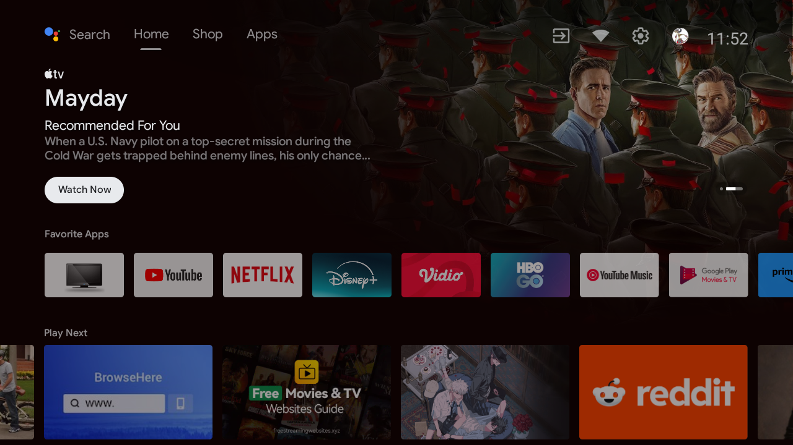
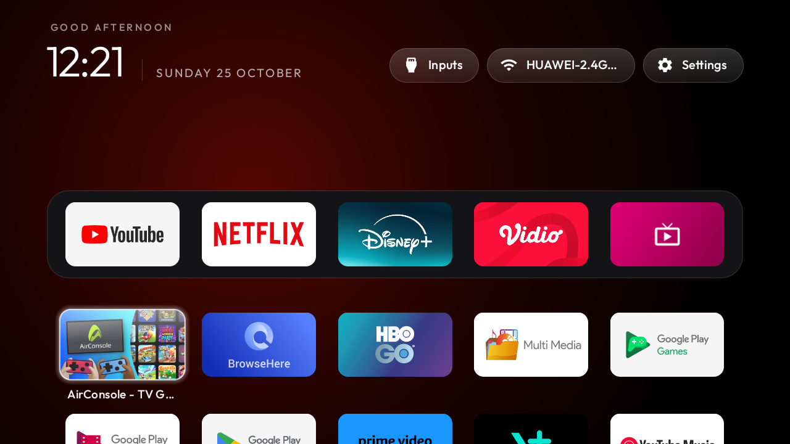
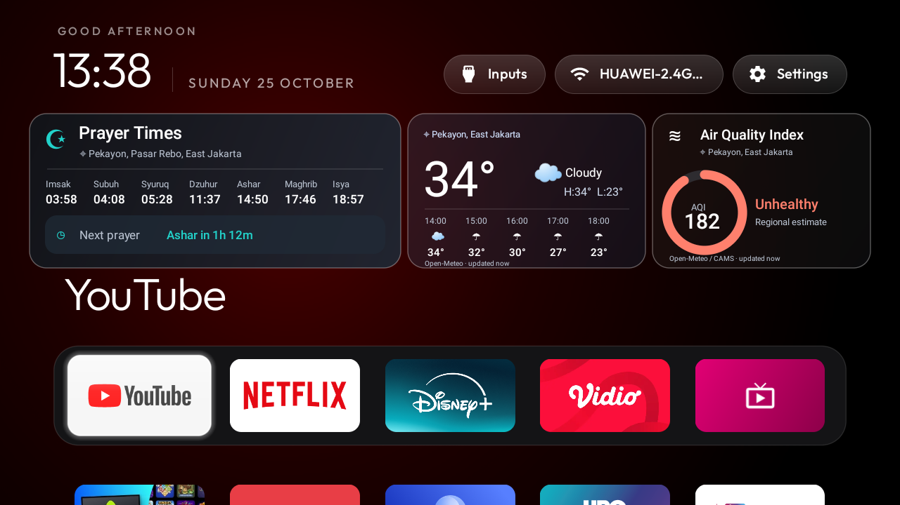

# Android TV Home Switcher & Safety Tool

Universal, non-destructive home screen switcher and disaster recovery tool for **any** Android TV and Google TV device:

```bash
./switch.sh status             # inspect TV hardware, active Home & stock detection
./switch.sh backup             # take full baseline backup (packages, settings & stock APK)
./switch.sh fresh              # Aqua TV Home, Apple TV-style grid, no widgets
./switch.sh widgets            # Aqua TV Home + Prayer Times, Weather and AQI cards
./switch.sh default            # instant revert to stock launcher (Google TV / Android TV)
./switch.sh restore            # one-click disaster recovery from saved backup
```

No root and no rebuilding are needed. It works across all TV brands (Sony, TCL, Xiaomi, Chromecast with Google TV, Philips, AQUA, Hisense, etc.) running Android 8.0 (API 26) through Android 14+ (API 34+).

| Default Stock TV | Aqua - Fresh Grid | Aqua - 3 Dashboard Cards |
| --- | --- | --- |
|  |  |  |

---

## Is it safe on other Android TV models?

**Yes, fundamentally safe**, because of how it operates:
1. **Non-destructive:** It **never uninstalls** or deletes system packages. System partitions remain 100% read-only.
2. **Stock launcher is preserved:** When switching to Aqua TV Home, your stock launcher is **never disabled**. It remains installed and enabled on the TV, ensuring that if anything ever happens to the custom launcher, the TV can never boot into a black screen.
3. **Safe fallbacks:** Standard Android intent categories (`android.intent.category.HOME`) are used to switch interfaces.

### What was previously device-specific & how it is now resolved:
* **Stock Launcher Package:** Previous scripts hardcoded `com.google.android.tvlauncher` (standard Android TV Leanback). On Google TV devices (Chromecast, Sony Google TV, TCL, etc.), the launcher is `com.google.android.apps.tv.launcherx`. On Xiaomi, it is `com.mitv.tvhome`. 
  * **Solution:** The tool now **dynamically auto-detects** your TV's native stock launcher and activity component.
* **Automatic Baseline Backup:** When switching a device for the first time, `switch.sh` automatically checks if a backup exists. If not, it generates a complete baseline backup before touching any home settings.
* **Architecture Independent:** The bundled Aqua APKs are pure Android Leanback bytecode with no native C/C++ libraries (`lib/`), meaning they execute natively across ARMv7, ARM64, and x86 chipsets.

---

## Safety & Backup System

### 1. What does the backup save?
Every backup is placed into a timestamped directory in `backups/<Device_Model>_<timestamp>/`:
* `device_info.txt` & `props_all.txt`: Device model, brand, manufacturer, Android version, SDK level, screen resolution, and density.
* `packages_all.txt`, `packages_enabled.txt`, `packages_disabled.txt`: Exact package status snapshots so any debloat or disabled app can be audited.
* `packages_system.txt` & `packages_thirdparty.txt`: Clean division of OEM system apps vs user apps.
* `settings_system.txt`, `settings_secure.txt`, `settings_global.txt`: Full dumps of Android TV settings namespaces.
* `stock_launcher.apk` (or `stock_launcher_apks/` for split APKs): Physical copy of your original TV launcher APK pulled directly from the TV.
* `restore.sh`: An **automated, self-contained disaster recovery script** created inside the backup folder.

### 2. How to create a backup
```bash
./backup.sh                   # back up default TV in .env
./backup.sh 192.168.1.50      # back up a specific TV IP
# or via switch.sh:
./switch.sh backup
```

### 3. How to restore
If anything goes wrong, you can restore your TV back to its factory stock state with a single command:
```bash
./restore.sh                  # restores from the latest backup
./restore.sh --list           # view all available device backups
./restore.sh backups/<folder> # restore a specific snapshot
# or directly run the script inside any backup directory:
./backups/Sony_Bravia_4K_20261025_163000/restore.sh
```

---

## Quick Start

### 1. TV Setup
1. On the TV, open **Settings -> System -> About** (or **Settings -> Device Preferences -> About**) and tap **Build** 7 times to enable Developer options.
2. In **Developer options**, turn on **USB debugging** and **Network debugging** (or "ADB debugging").
3. Note your TV's IP address (*Settings -> Network & Internet -> Network status*).
4. Run `./switch.sh status <TV_IP>`. When the TV prompts **Allow debugging?**, select **Always allow**.

### 2. Switch Home Screens
```bash
# Check status and auto-detected stock launcher
./switch.sh status

# Switch to clean Aqua Apple TV-style grid
./switch.sh fresh

# Switch to Aqua with Prayer Times, Weather & AQI widgets
./switch.sh widgets

# Revert to TV's native stock launcher anytime
./switch.sh default
```

You can target any TV on your network by passing its IP directly:
```bash
./switch.sh fresh 192.168.1.50
./switch.sh status 192.168.1.75
```

---

## Available Modes

| Mode | Aliases | Description |
| --- | --- | --- |
| `default` | `stock`, `1` | TV's original stock launcher (Google TV, Android TV, PatchWall, etc.) |
| `fresh` | `appletv`, `apple`, `2` | Aqua TV Home with 5-slot dock and clean app grid |
| `widgets` | `dashboard`, `3` | Aqua TV Home with Prayer Times, Weather & AQI live cards |
| `backup` | `snapshot`, `dump` | Complete baseline snapshot of device state and stock APK |
| `restore` | `recover`, `reset` | Revert to stock launcher and restore all original package states |

---

## Configuration (`.env`)

All defaults can be customized in `.env` (copy from `.env.example`):

| Variable | Default | Meaning |
| --- | --- | --- |
| `TV_HOST` | `192.168.100.2` | Default TV IP address (can also be passed via CLI) |
| `TV_PORT` | `5555` | ADB TCP port |
| `ADB_PATH` | auto-detected | Path to `adb` binary (checked in Android SDK, brew, PATH) |
| `CONNECT_TIMEOUT` | `20` | Connection timeout in seconds |
| `STOCK_PACKAGE` | auto-detected | Override auto-detected stock launcher (e.g. `com.google.android.apps.tv.launcherx`) |
| `STOCK_ACTIVITY` | auto-detected | Override stock activity (e.g. `.home.HomeActivity`) |

---

## Troubleshooting & TV Quirks

| Symptom | Cause & Solution |
| --- | --- |
| `adb was not found` | Install Android platform-tools (`brew install android-platform-tools` on macOS) or set `ADB_PATH` in `.env`. |
| `Connection refused` | Network debugging is turned off on the TV, the TV is asleep, or the IP address changed via DHCP. Check IP and toggle Network debugging on TV. |
| `unauthorized` | Accept the **Allow debugging?** prompt on the TV screen. If it doesn't appear, toggle USB debugging off and on. |
| Home remote button still opens Google TV | Newer Google TV devices (Android 11-14) intercept the HOME key. When pressing HOME for the first time, Android will prompt you to choose your home launcher; select **Aqua TV Home** and choose **Always**. |
| `INSTALL_FAILED_UPDATE_INCOMPATIBLE` | An existing launcher build with a different signature is installed. Run `adb uninstall com.gathin.tvhome` and switch again. |
| Revert in emergency without terminal | Go to **Settings -> Apps -> See all apps -> Aqua TV Home -> Uninstall**. Your TV will immediately drop back to the stock launcher. |

---

## OS Version Compatibility Matrix

| Android TV / Google TV Version | API Level | Stock Launcher | Aqua TV Home Compatibility | Notes |
| :--- | :--- | :--- | :--- | :--- |
| **Android 8.0 & 8.1 (Oreo)** | 26 - 27 | `com.google.android.tvlauncher` | ✅ Full support | Uses legacy `pm set-home-activity` fallback. |
| **Android 9.0 (Pie)** | 28 | `com.google.android.tvlauncher` | ✅ Full support | Standard Leanback launcher. |
| **Android 10 (Q)** | 29 | `com.google.android.tvlauncher` | ✅ Full support | Introduced `cmd package set-home-activity`. |
| **Android 11 (R)** | 30 | `com.google.android.tvlauncher` / `launcherx` | ✅ Full support | Verified on MediaTek/Haier/AQUA boards. |
| **Android 12 & 12L (S)** | 31 - 32 | `com.google.android.apps.tv.launcherx` | ✅ Full support | Press HOME on remote once and choose "Always". |
| **Android 13 (Tiramisu)** | 33 | `com.google.android.apps.tv.launcherx` | ✅ Full support | Supported across Google TV models. |
| **Android 14 (Upside Down Cake)** | 34 | `com.google.android.apps.tv.launcherx` | ✅ Full support | Includes shell push fallback for strict install checks. |
| **Pre-Android 8.0 (Android 6 / 7)** | ≤ 25 | Legacy Leanback / AOSP | ⚠️ Needs source recompile | `minSdk` is 26. Can be lowered to 24 in `launcher/app/build.gradle`. |

*Note: Samsung TVs (Tizen OS) and LG TVs (webOS) do not run Android OS and are not supported.*

---

## Modifying & Compiling New Modes (`launcher/` & `build.sh`)

The repository now contains the complete Java and XML source code in `launcher/`:

```
launcher/
├── app/src/main/java/com/gathin/tvhome/
│   ├── MainActivity.java           # Launcher lifecycle and view hierarchy
│   ├── DashboardRepository.java    # Prayer Times, Weather & AQI network feeds
│   ├── DashboardView.java          # Dashboard UI rendering
│   └── Config.java                 # Configuration bindings
└── app/src/main/res/values/
    └── config.xml                  # Dock apps, hidden apps, column count & layout
```

### How to customize:
1. **Change pinned dock apps:** Edit `<string-array name="dock_apps">` in `launcher/app/src/main/res/values/config.xml`.
2. **Change fallback coordinates:** Edit `SAVED_LAT` and `SAVED_LON` in `launcher/app/src/main/java/com/gathin/tvhome/DashboardRepository.java`.
3. **Compile new APKs:**
   ```bash
   ./build.sh fresh       # Recompiles apks/aqua-tv-home-fresh.apk
   ./build.sh widgets     # Recompiles apks/aqua-tv-home-widgets.apk
   ./build.sh all         # Recompiles both variants
   ```

---

## Repository Structure

```
androidtv-switcher-launcher/
├── switch.sh                       # Universal launcher switcher & coordinator
├── backup.sh                       # Standalone Android TV backup utility
├── restore.sh                      # Top-level disaster recovery launcher
├── build.sh                        # Recompiles fresh/widgets APKs from source
├── launcher/                       # Complete Java & XML Android Gradle source
├── .env                            # Local TV IP configuration (git-ignored)
├── .env.example                    # Configuration template
├── .gitignore
├── apks/
│   ├── aqua-tv-home-fresh.apk      # Aqua build without dashboard
│   ├── aqua-tv-home-widgets.apk    # Aqua build with 3 cards
│   ├── SHA256SUMS
│   ├── FONT-LICENSE-OFL.txt        # Outfit font licence
│   └── LICENSE-cleanyourtv         # launcher source licence (MIT)
├── backups/                        # Device snapshots & restore kits (git-ignored)
│   └── .gitkeep
├── docs/                           # Screenshot previews
└── README.md
```

Launcher source: [Gathin23/cleanyourtv](https://github.com/Gathin23/cleanyourtv) (MIT). Aqua TV Home is package `com.gathin.tvhome` v2.7 (code 8), minSdk 26 (Android 8.0+), targetSdk 34 (Android 14).
