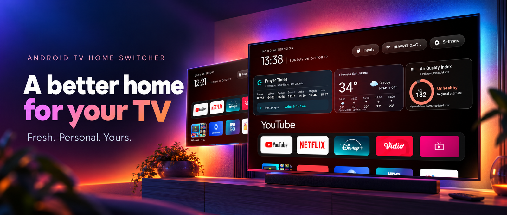
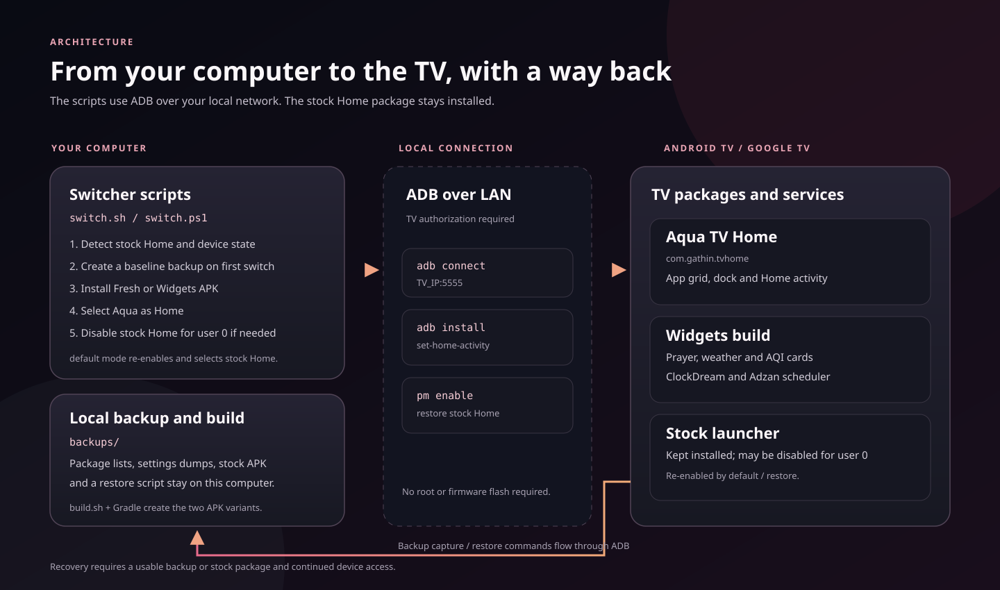

# Android TV Home Switcher

Switch an Android TV or Google TV between its stock Home screen and **Aqua TV Home**, a glass-style launcher with an optional clock and information dashboard. The scripts install a supplied APK over ADB, keep the stock launcher installed, and save a local backup before the first switch.



## Screenshots

|                            Stock Home                             |                               Fresh mode                                |                                              Widgets mode                                              |
| :---------------------------------------------------------------: | :---------------------------------------------------------------------: | :----------------------------------------------------------------------------------------------------: |
|  |  |  |
|                         Original launcher                         |                            App grid and dock                            |                          Clock, prayer times, weather, air quality, and Adzan                          |

The TV launcher artwork used by Android is [a separate 320×180 banner](launcher/app/src/main/res/drawable-nodpi/banner.jpg).

## Features

- **Liquid Glass throughout.** The focus slab, the information cards and the dock share one edge treatment: a diagonal specular highlight that catches the top-left and bottom-right of each shape, a soft ambient glow, and a selection that glides between tiles on a spring instead of jumping.
- **Two styles from the same source.** _Fresh_ is the clean Apple TV-style grid with a five-slot dock and no cards. _Widgets_ adds the digital clock and the three information cards.
- **Three live cards.**
  - **Prayer times** — the seven slots the feed returns (Imsak, Subuh, Syuruq, Dzuhur, Ashar, Maghrib, Isya) with a countdown pill to the next call.
  - **Weather** — current temperature and condition, today's high and low, and a five-hour strip.
  - **Air quality** — a US AQI ring with the band name (Good, Moderate, Sensitive groups, Unhealthy, and so on).
- **Indonesian mosque gallery screensaver.** The widgets build rotates through 30 bundled Wikimedia Commons mosque photographs every minute, works offline, and keeps the clock, prayer, weather, and AQI cards visible. Each image includes its mosque, location, photographer, and license.
- **Adzan over whatever is playing.** One exact alarm per prayer opens a full-screen 1080p video with audio, from Home, from the screensaver, or while a streaming app is in front. Back or the on-screen button closes it and returns you to the app underneath.
- **Reversible.** The stock launcher stays installed and is only disabled once the new Home is confirmed, and `default` puts it back. Nothing is flashed and nothing is uninstalled for you.
- **Small and quiet.** R8 shrinking, hardware-decoded video, no web views and no analytics. The launcher talks to AlAdhan and Open-Meteo for the cards and to nothing else.

## Requirements

- An Android TV or Google TV device running **Android 8.0 / API 26 or newer**. OEM behavior varies; a supported API level does not guarantee that a TV permits changing Home.
- A computer and TV on the same local network, with [Android platform-tools (adb)](https://developer.android.com/tools/releases/platform-tools) installed.
- Developer options and ADB/network debugging enabled on the TV. Accept the computer's authorization prompt on the TV.
- The included APKs in [apks/](apks/) or locally built replacements.

Changing the Home app affects the TV's user settings. Read [Backup and recovery](#backup-and-recovery) before switching, and keep ADB access available until Home works on your device.

## Quick start

1. On the TV, open **Settings → System → About**, select **Build** seven times, then enable **USB debugging** and **Network debugging / ADB debugging** under Developer options. Menu names vary by manufacturer. Find the TV's IP address in network settings.
2. From this repository, check the connection. Replace the example address with your TV's IP:

   ```bash
   ./switch.sh status 192.168.1.50
   ```

   On Windows PowerShell, use `.\switch.ps1 status 192.168.1.50`. Accept the ADB prompt on the TV if one appears.

3. Switch modes:

   | Action                | macOS / Linux                            | Windows PowerShell                        |
   | --------------------- | ---------------------------------------- | ----------------------------------------- |
   | Fresh launcher        | `./switch.sh glass 192.168.1.50`         | `.\switch.ps1 glass 192.168.1.50`         |
   | Launcher with widgets | `./switch.sh glass-widgets 192.168.1.50` | `.\switch.ps1 glass-widgets 192.168.1.50` |
   | Return to stock Home  | `./switch.sh default 192.168.1.50`       | `.\switch.ps1 default 192.168.1.50`       |

The first switch creates a baseline snapshot in `backups/` unless `--no-backup` (shell) or `-NoBackup` (PowerShell) is supplied. This directory is ignored by Git. You can copy [.env.example](.env.example) to `.env` and set `TV_HOST`, then omit the IP from later commands. Do not commit `.env` or a TV backup.

Use `./switch.sh list` or `./switch.sh --help` for shell aliases and options. In PowerShell, use `.\switch.ps1 -Help`.

## How the remote works

- **HOME** opens Aqua TV Home. The switch selects it as the default Home and disables the stock launcher for user 0, so the remote cannot quietly fall back to the factory screen. It also points the remote's Home key at the launcher through the bundled accessibility service.
- **BACK** inside an app behaves as that app decides: most streaming apps leave to Home, some keep their own previous screen. The launcher does not intercept Back.
- **Switching back** with `./switch.sh default` re-enables the stock launcher, and HOME behaves exactly as it did before.
- The launcher's dialogs, tile menu and reordering are all driven from the D-pad: arrows move, OK selects, Back closes.

## Modes and data

| Mode                        | APK                         | Features                                                                           |
| --------------------------- | --------------------------- | ---------------------------------------------------------------------------------- |
| `glass` / `fresh`           | `apks/glass-tv-fresh.apk`   | Glass-style app grid and dock                                                      |
| `glass-widgets` / `widgets` | `apks/glass-tv-widgets.apk` | Dashboard cards, clock screensaver with mosque gallery, and scheduled Adzan player |
| `default` / `stock`         | None                        | Re-enables and selects the detected stock launcher                                 |

The widgets build reads the TV's location when available. Prayer times come from [AlAdhan](https://aladhan.com/) using the Kemenag calculation method; weather and US AQI come from [Open-Meteo](https://open-meteo.com/). If location is unavailable, the code uses a fallback in East Jakarta. These cards require network access and may be empty or stale offline.

Adzan is scheduled with one exact OS alarm per prayer. If Android or the OEM withholds exact alarms, the call can fire late; the app logs this rather than pretending it is exact. Playback depends on the TV's alarm and activity behavior, so test it on your device before relying on it. The switchers grant `SYSTEM_ALERT_WINDOW`, which the launcher never draws with: it is the exemption that lets the alarm open the call to prayer while another app is in front.

The launcher also provides a `ClockDream` screensaver service. Select **Aqua TV Home Clock** in the TV's screensaver settings if your firmware exposes that option. A configured `clock_wallpaper` still overrides the bundled mosque gallery.

### What the Adzan does, and what it does not

- Both videos are 1920×1080 H.264 with AAC audio: the standard call runs 3:20 and the Subuh call runs 3:51. Sources and credits are in [THIRD_PARTY_NOTICES.md](THIRD_PARTY_NOTICES.md).
- The alarm is one-shot and is re-armed after each call, on boot, and when the clock or time zone changes.
- The call opens a full-screen activity and takes the audio focus, so Android pauses the app underneath. Closing the call returns you to that app; whether it resumes playback by itself is up to that app, not something the launcher can force.
- Back, the on-screen Close button, or the end of the video all end the call. If a system dialog or the keyguard interrupts it, playback pauses and resumes rather than dying.
- If the notification permission is refused on Android 13+, the alarm still opens the call directly; only the notification is skipped.

## Configuration and privacy

Copy `.env.example` to `.env` to save a TV address and optional overrides. The most useful settings are:

| Setting                           | Purpose                                                   |
| --------------------------------- | --------------------------------------------------------- |
| `TV_HOST`, `TV_PORT`              | TV network address; the example port is `5555`            |
| `ADB_PATH`                        | Explicit path to `adb` when it is not on `PATH`           |
| `STOCK_PACKAGE`, `STOCK_ACTIVITY` | Override automatic stock Home detection for an unusual TV |
| `FRESH_APK`, `WIDGETS_APK`        | Use alternate local APK files in the shell switcher       |

To change pinned dock apps, edit the `dock_apps` array in [config.xml](launcher/app/src/main/res/values/config.xml), then rebuild the APKs. To change the widget fallback location, edit `SAVED_LAT` and `SAVED_LON` in [DashboardRepository.java](launcher/app/src/main/java/com/gathin/tvhome/DashboardRepository.java).

The widgets build sends location coordinates to AlAdhan and Open-Meteo to obtain its cards. The switcher saves device properties, package lists, settings dumps, and a stock launcher APK under the local `backups/` directory. Treat those backups as private device data.

## Backup and recovery

`switch.sh` detects the stock Home, creates a backup on the computer, installs the chosen APK, and selects it as Home. Only after the new Home is confirmed to resolve does it disable the stock launcher **for user 0**; if the install or the switch fails, the stock launcher is left enabled and the script stops. It does not uninstall the stock launcher. [The architecture diagram](docs/architecture.svg) shows the switch and restore path.



To return to the factory Home choice, run `./switch.sh default` or `.\switch.ps1 default`. To restore package state captured in a backup, run `./switch.sh restore` or `.\switch.ps1 restore`; both read the newest folder under `backups/`, re-enable the packages recorded there, and put the stock Home back. The shell backup tool also writes a restore script inside each backup folder. Run `./switch.sh backup` to make another snapshot before experimenting.

Recovery depends on the stock package still being present, the backup being usable, and ADB remaining accessible. Uninstalling the launcher without running `./switch.sh default` first does **not** bring the stock Home back: the switch disables the stock launcher, so re-enable it over ADB (`pm enable --user 0 <stock package>`) or from the TV's Settings before removing Aqua TV Home. If Home will not open, use the TV's Settings app to re-enable the stock launcher. Consult the manufacturer's recovery steps if those controls are unavailable.

## FAQ

### It says `Could not connect` or `Connection refused`

Check that **Network debugging** (or USB debugging) is still on in Developer options, that the TV is awake, and that the IP has not changed. `./switch.sh status <ip>` says which of those is failing.

### It says `unauthorized`

Look at the TV: accept the **Allow USB debugging?** prompt and tick _Always allow from this computer_. Then rerun the command.

### It says `adb was not found`

Install Android platform-tools and make sure `adb` is on `PATH`, or set `ADB_PATH` in `.env`.

```powershell
winget install Google.PlatformTools   # Windows
```

```bash
brew install android-platform-tools   # macOS
```

### Google TV asks "Complete action using…" when I press HOME

That is the system's launcher picker, not an error. Select **Aqua TV Home** and choose **Always**. If the picker keeps appearing, run `./switch.sh status` to see whether the stock launcher is still the selected Home.

### Where do the prayer times, weather and air quality come from?

The widgets build asks the TV for its location and then queries AlAdhan (Kemenag method) for prayer times and Open-Meteo for weather and US AQI. Without a location fix it falls back to East Jakarta coordinates, which you can change in `DashboardRepository.java`.

### How do I enable the screensaver?

In **Settings → System → Screensaver** (or _Device Preferences → Screensaver_) pick **Aqua TV Home Clock**. Over ADB, the equivalent is:

```bash
adb shell settings put secure screensaver_components com.gathin.tvhome/.ClockDream
```

On an OLED panel, set `clock_glow` to `false` in [config.xml](launcher/app/src/main/res/values/config.xml) for a plain black background with the same drift.

### How does the Adzan behave while a movie is playing?

The alarm opens the full-screen call on top of the app; Android pauses that app while the call has the screen. Closing the call returns you to it. The launcher cannot force another app to resume playback, so what happens next is that app's own behaviour.

### The Adzan fired late

The call needs exact alarms. On Android 12+ the grant can be withheld by the OEM or the user: check **Settings → Apps → Special app access → Alarms & reminders** for Aqua TV Home, and note that the launcher logs when its exact alarm request was downgraded.

### What are the Adzan videos?

Both are 1080p H.264/AAC and ship inside the APK (about 45 MB of its size): the standard call is 3:20 and the Subuh call is 3:51. Attribution for both is in [THIRD_PARTY_NOTICES.md](THIRD_PARTY_NOTICES.md).

### Why is the APK so large?

Almost all of it is the two videos. If you do not want the Adzan, build the fresh variant, which keeps the videos out of the dashboard path — the assets themselves are still bundled, so a smaller build means removing `res/raw/adzan*.mp4` from a local fork.

### Can I go back to the factory screen without a computer?

Only if the stock launcher is still enabled. Run `./switch.sh default` first (from any machine with adb), or use **Settings → Apps → Aqua TV Home** to re-enable the stock launcher before uninstalling. Uninstalling first leaves the TV without a Home screen.

## Troubleshooting

| Symptom                         | Check                                                                                                           |
| ------------------------------- | --------------------------------------------------------------------------------------------------------------- |
| `adb` not found                 | Install Android platform-tools and ensure `adb` is on `PATH`, or set `ADB_PATH` in `.env`.                      |
| Connection refused or timed out | Confirm the TV IP, port, debugging setting, and that both devices are on the same network.                      |
| `unauthorized`                  | Accept the debugging authorization dialog on the TV, then rerun `status`.                                       |
| APK install failed              | Check TV storage and whether an installed build uses a different signing key. Uninstalling clears app settings. |
| HOME still opens the old screen | Check `status`, the default Home selection prompt, and OEM launcher restrictions.                               |
| Empty dashboard card            | Check internet and location access. The fallback location is in `DashboardRepository.java`.                     |

Preview a switch with `./switch.sh glass 192.168.1.50 --dry-run` or `.\switch.ps1 glass 192.168.1.50 -DryRun`. The scripts still need device access to detect the TV and its launcher.

## Build from source

The Android app uses Java 17, Android Gradle Plugin 8.5.2, Gradle wrapper 8.14, `compileSdk`/`targetSdk` 34, and `minSdk` 26. Install JDK 17 and Android SDK 34, then run:

```bash
./build.sh glass
./build.sh glass-widgets
# or ./build.sh all
```

`build.sh` flips the `dashboard_panels` flag in [config.xml](launcher/app/src/main/res/values/config.xml) to select a mode, builds the APK, copies it to `apks/`, and puts `config.xml` back afterwards. To run JVM unit tests directly:

```bash
cd launcher
./gradlew :app:testDebugUnitTest
```

### Android TV OS compatibility

| Android version         | API   | Stock launcher                         | Notes                                                        |
| ----------------------- | ----- | -------------------------------------- | ------------------------------------------------------------ |
| 8.0 – 8.1 (Oreo)        | 26–27 | `com.google.android.tvlauncher`        | Works; both switchers fall back to `pm set-home-activity`    |
| 9 (Pie) – 10 (Q)        | 28–29 | `com.google.android.tvlauncher`        | Works                                                        |
| 11 (R)                  | 30    | `tvlauncher` or `tv.launcherx`         | Works; OEM firmware differences show up most at this version |
| 12 – 12L (S)            | 31–32 | `com.google.android.apps.tv.launcherx` | Works; exact-alarm permission can be withheld                |
| 13 (Tiramisu)           | 33    | `com.google.android.apps.tv.launcherx` | Works; notification permission is optional                   |
| 14 (Upside Down Cake)   | 34    | `com.google.android.apps.tv.launcherx` | Works; install falls back to a shell push when needed        |
| 6 – 7.1 (pre-Android 8) | ≤ 25  | Legacy AOSP / Leanback                 | Requires lowering `minSdk` in `launcher/app/build.gradle`    |

A supported API level is not a guarantee: some OEM firmwares forbid changing Home, and no script can override that.

### Repository structure

```
androidtv-switcher-launcher/
├── switch.sh                  # macOS/Linux switcher (glass, glass-widgets, default, status, backup, restore)
├── switch.ps1                 # Windows PowerShell switcher, same modes
├── switch.bat                 # Windows double-click wrapper for switch.ps1
├── backup.sh                  # Standalone backup: packages, settings, home candidates, stock APK
├── restore.sh                 # Restores the newest backup by running its generated restore script
├── build.sh                   # Rebuilds the fresh and widgets APKs from source
├── docs/                      # Screenshots, banner and architecture diagram
├── apks/                      # Compiled release APKs and their SHA256SUMS
├── backups/                   # Local TV snapshots (git-ignored)
├── .env.example               # Configuration template
└── launcher/                  # Android Gradle project: Java 17, AGP 8.5.2, minSdk 26
    └── app/src/main/
        ├── java/com/gathin/tvhome/   # Home, dashboard, adzan, screensaver, theming
        └── res/                      # Layouts, strings in 24 languages, config.xml, media
```

| Path                                                                                              | Purpose                                          |
| ------------------------------------------------------------------------------------------------- | ------------------------------------------------ |
| [switch.sh](switch.sh), [switch.ps1](switch.ps1)                                                  | Connect, install, select Home, and report status |
| [backup.sh](backup.sh), [restore.sh](restore.sh)                                                  | Snapshot and restore TV package state            |
| [MainActivity.java](launcher/app/src/main/java/com/gathin/tvhome/MainActivity.java)               | Main launcher activity                           |
| [PrayerTimes.java](launcher/app/src/main/java/com/gathin/tvhome/PrayerTimes.java)                 | Prayer matching and scheduling rules             |
| [AdzanActivity.java](launcher/app/src/main/java/com/gathin/tvhome/AdzanActivity.java)             | Full-screen call to prayer host                  |
| [DashboardRepository.java](launcher/app/src/main/java/com/gathin/tvhome/DashboardRepository.java) | Widget data and fallback location                |
| [config.xml](launcher/app/src/main/res/values/config.xml)                                         | Build-time widget flag and default dock apps     |
| [AndroidManifest.xml](launcher/app/src/main/AndroidManifest.xml)                                  | Home, screensaver, services, and permissions     |

## Contributing and project policies

See [Contributing](CONTRIBUTING.md) for the development workflow and commit format, [Code of Conduct](CODE_OF_CONDUCT.md) for community expectations, and [Security](SECURITY.md) for private vulnerability reports.

## Credits

Android TV Home Switcher was built with reference to and inspiration from these open-source projects:

- [Gathin23/cleanyourtv](https://github.com/Gathin23/cleanyourtv) — Android TV cleanup and launcher switching workflow.
- [cocombee/glass-tv](https://github.com/cocombee/glass-tv) — the Glass TV launcher design and source foundation.

Thank you to their authors and contributors for making their work available. Please retain the applicable upstream attribution and license notices when redistributing derived work.

Project code and documentation are offered under the [MIT License](LICENSE). That license does **not** grant rights to third-party media, fonts, app icons, or trademarks. See [third-party notices](THIRD_PARTY_NOTICES.md) and the bundled [font license](launcher/FONT-LICENSE-OFL.txt).
